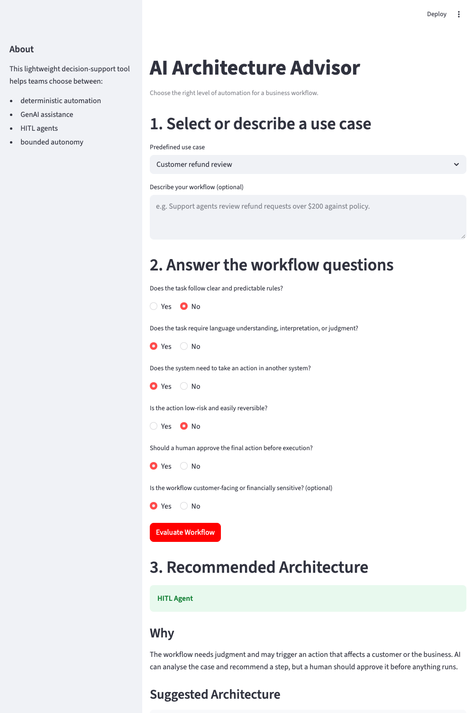

# AI Architecture Advisor

**[Live demo →](https://workflow-autonomy-advisor-gnufzu3ycnqmr6nwserhxr.streamlit.app/)**

## Overview

AI Architecture Advisor is a lightweight Streamlit decision-support app that helps product teams determine whether a business workflow is better suited for deterministic automation, a GenAI assistant, a human-in-the-loop agent, or a bounded autonomous agent.

## Why This Project

Not every workflow needs an AI agent. The goal is to choose the simplest architecture capable of solving the business problem while balancing judgment, action, risk, and human oversight.

## Architecture Patterns

- **Deterministic Automation**: clear rules and predictable output. No LLM needed.
- **GenAI Assistant**: language understanding or judgment is needed, but the system does not act. A human owns the final decision.
- **HITL Agent**: the AI reasons and may use tools to act, but a human approves the final step.
- **Bounded Autonomous Agent**: the AI can act on its own for low-risk, reversible actions inside clear policy limits.

## Example Use Cases

| Use Case | Recommended Architecture |
|---|---|
| Password reset | Deterministic Automation |
| Meeting summary | GenAI Assistant |
| Customer refund review | HITL Agent |
| Low-value refund within policy limits | Bounded Autonomous Agent |
| Contract negotiation | Human-led with AI assistance / GenAI Assistant |

Selecting a use case pre-fills the questions. You can change any answer before evaluating.

## Decision Logic

The first version uses transparent deterministic Python rules, based on:

- **Rule clarity**: does the task follow clear, predictable rules?
- **Judgment required**: does it need language understanding or interpretation?
- **Action required**: does it need to act in another system?
- **Risk and reversibility**: is the action low-risk and easy to undo?
- **Human approval**: should a person approve the action first?

The rules are checked in order:

1. Clear rules and no judgment → Deterministic Automation
2. Judgment and no action → GenAI Assistant
3. Action and human approval → HITL Agent
4. Action and low risk → Bounded Autonomous Agent
5. Any other action (risky, no approval gate) → HITL Agent
6. Anything else → GenAI Assistant

An optional sixth question flags workflows that are customer-facing or financially sensitive. If that is yes and the workflow takes an action, the result is upgraded to HITL Agent, even when the other answers point to autonomy.

## Screenshot



## Tech Stack

- Python
- Streamlit

## Run Locally

```bash
pip install -r requirements.txt
streamlit run app.py
```

## Project Structure

```text
workflow-autonomy-advisor/
├── app.py
├── README.md
└── requirements.txt
```

## Future Iterations

- Week 2: add LLM prompting and context
- Week 3: add agentic workflows and tools
- Week 4: add evaluations and observability
- Week 5: add production readiness and ROI
